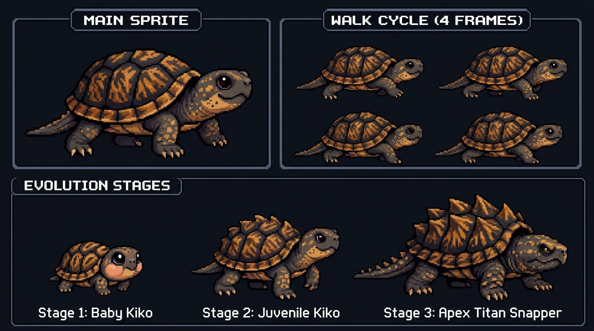

# Kiko Profile 🐢

<p align="center">
  
</p>

<p align="center">
  <b>Draw an animated pixel-art snapping turtle walking across your GitHub profile README, powered by your contributions.</b>
</p>

<p align="center">
  <a href="https://github.com/rtomswastaken/kiko-profile/actions/workflows/test.yml"></a>
  <a href="https://github.com/rtomswastaken/kiko-profile/blob/main/LICENSE"></a>
  <a href="https://github.com/rtomswastaken/kiko-profile/releases"></a>
</p>

---

## 🌟 Overview

**`kiko-profile`** creates a smooth, animated pixel-art snapping turtle named **Kiko** that crawls across a horizontal banner from one end of your GitHub README to the other, turns around, and crawls back in a seamless loop.

### 🧬 Dynamic Evolution Stages
Kiko grows and evolves according to your public GitHub contributions:

| Stage | Form | Required Contributions | Behavior |
| :--- | :--- | :--- | :--- |
| **Stage 1** | **Baby Hatchling** | `< 150` | Cute chubby cheeks, shiny puppy eyes, miniature spotted paws. |
| **Stage 2** | **Juvenile Snapper** | `150 – 499` | Classic tiger-striped scutes, spunky posture, agile crawl cycle. |
| **Stage 3** | **Apex Titan Snapper** | `500+` | Prehistoric alligator-snapping turtle spikes, armored hooked beak, and jagged tail. |

### ⚡ Activity-Driven Gait
- **Active Sprint (55ms)**: When you've contributed today or have a streak of 5+ days, Kiko walks with extra purpose!
- **Steady Crawl (65ms)**: Standard active pacing.
- **Leisurely Amble (80ms)**: Slow, calm, relaxed walk on quiet days.

---

## 🚀 Quick Start: Add Kiko to Your GitHub Profile

### 1. Add the GitHub Action Workflow
In your special profile repository (`username/username`), create `.github/workflows/kiko.yml`:

```yaml
name: Kiko Profile Companion

on:
  schedule:
    # Runs automatically shortly after midnight UTC
    - cron: '20 0 * * *'
  workflow_dispatch:

permissions:
  contents: write

concurrency:
  group: kiko-profile
  cancel-in-progress: false

jobs:
  kiko:
    runs-on: ubuntu-latest
    steps:
      - name: Checkout repository
        uses: actions/checkout@v4
        with:
          fetch-depth: 0

      - name: Generate Kiko Snapping Turtle
        uses: rtomswastaken/kiko-profile@v1
        with:
          stage: auto
          background: transparent
          output-dir: assets/kiko

      - name: Commit and push changes
        shell: bash
        run: |
          git add assets/kiko/kiko.gif assets/kiko/kiko.png
          if git diff --cached --quiet; then
            echo "Kiko is unchanged; nothing to commit."
            exit 0
          fi
          git config user.name "github-actions[bot]"
          git config user.email "41898282+github-actions[bot]@users.noreply.github.com"
          git commit -m "chore(profile): update walking kiko companion [skip ci]"
          git push origin HEAD
```

### 2. Embed into Your `README.md`
Add this snippet wherever you want Kiko to crawl across your profile:

```html
<p align="center">
  
</p>
```

---

## ⚙️ Configuration & Options

| Input | Description | Default | Options |
| :--- | :--- | :--- | :--- |
| `login` | GitHub username whose activity to draw | `${{ github.repository_owner }}` | Any valid GitHub handle |
| `stage` | Evolution stage | `auto` | `auto`, `baby`, `juvenile`, `titan` |
| `background` | Background style | `transparent` | `transparent`, `dark` (`#0d1117`), or custom `#hex` |
| `output-dir` | Target directory for outputs | `kiko` | Path relative to repository root |
| `width` | Banner canvas width (pixels) | `840` | Integer (e.g. `840`, `900`) |
| `height` | Banner canvas height (pixels) | `80` | Integer (e.g. `80`, `96`) |
| `token` | GitHub access token | `${{ github.token }}` | Required for private contribution totals |

---

## 💻 Local CLI Usage

You can also run `kiko-profile` locally from your terminal:

```bash
# Clone and install
git clone https://github.com/rtomswastaken/kiko-profile.git
cd kiko-profile
pip install -e .

# Generate for any user
kiko-profile rtomswastaken --output-dir out --stage auto --background transparent

# Force Titan form with GitHub Dark background
kiko-profile rtomswastaken --output-dir out --stage titan --background dark
```

---

## 🎨 Master Pixel Art Concept

Created based on the original Kiko mascot:

<p align="center">
  
</p>

---

## 📄 License

[MIT](LICENSE) © 2026 [Richardsen Thomas](https://github.com/rtomswastaken)
